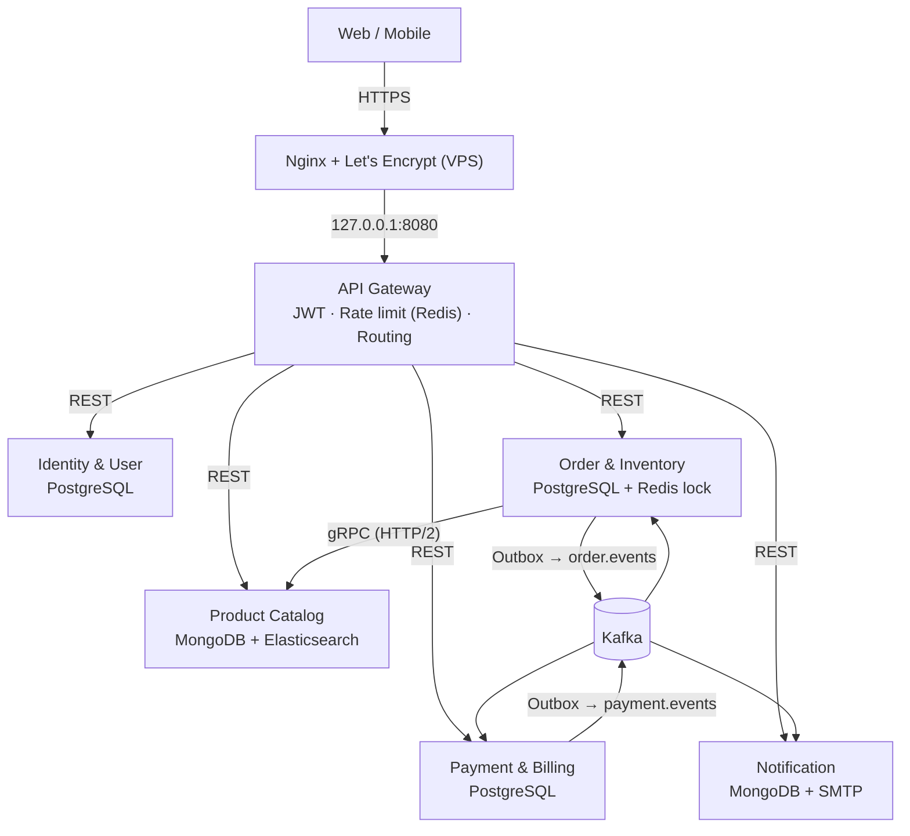

# Omnichannel E-Commerce Platform (Microservices)

Hệ thống thương mại điện tử đa kênh theo kiến trúc microservices: **Spring Boot 3 / Java 17, Spring Cloud Gateway, gRPC, Kafka, PostgreSQL, MongoDB, Elasticsearch, Redis**, triển khai bằng Docker Compose lên VPS và có CI/CD qua GitHub Actions.

> Đề tài: [De_Tai_1_Omnichannel_ECommerce.md](https://github.com/haibtrikkei/JB-IOC-251229-Microservice_DeTaiProject/blob/master/De_Tai_1_Omnichannel_ECommerce.md)

## 1. Kiến trúc



| Service | Port | Lưu trữ | Vai trò |
|---|---|---|---|
| `api-gateway` | 8080 | Redis | Điểm vào duy nhất; xác thực JWT, rate limit theo user/IP, routing, gom Swagger |
| `identity-service` | 8081 | PostgreSQL `identity_db` | Đăng ký/đăng nhập, access + refresh token (rotation), địa chỉ, RBAC (CUSTOMER/STAFF/ADMIN) |
| `product-service` | 8082 (+gRPC 9090) | MongoDB `product_db`, Elasticsearch | Danh mục, sản phẩm, biến thể SKU, tìm kiếm full-text không dấu |
| `order-service` | 8083 | PostgreSQL `order_db`, Redis | Đặt hàng, máy trạng thái đơn, tồn kho real-time, giữ hàng, Saga, Outbox |
| `payment-service` | 8084 | PostgreSQL `payment_db` | VNPay sandbox + cổng mock (HMAC), webhook/IPN, hoàn tiền, đối soát |
| `notification-service` | 8085 | MongoDB `notification_db` | Email (SMTP) + hộp thư in-app, lắng nghe mọi event |

Chi tiết thiết kế (Bounded Context, Race Condition, Saga, Outbox): [docs/architecture.md](docs/architecture.md) ·
Danh sách API: [docs/api.md](docs/api.md) · Kịch bản demo: [docs/demo.md](docs/demo.md) · Triển khai VPS: [docs/deployment.md](docs/deployment.md)

## 2. Cấu trúc thư mục

```
├── common/                 # ApiResponse chuẩn, xử lý lỗi, CurrentUser, hợp đồng event Kafka
├── proto/                  # product.proto (gRPC Order -> Product)
├── api-gateway/  identity-service/  product-service/  order-service/  payment-service/  notification-service/
│   └── Dockerfile          # multi-stage build cho từng service
├── docker-compose.yml               # môi trường dev/demo (build từ source)
├── docker-compose.production.yml    # VPS: image từ GHCR, không publish port DB
├── docker-compose.monitoring.yml    # Prometheus, Grafana, Loki, Promtail, Jaeger
├── deploy/                 # nginx, script cài VPS, init DB, cấu hình monitoring
├── load-test/              # k6: flash-sale.js (chịu tải) và smoke.js (end-to-end)
└── .github/workflows/      # ci.yml, deploy.yml
```

## 3. Chạy trên máy local

Yêu cầu: Docker Desktop (khuyến nghị cấp ≥ 6 GB RAM). Không cần cài Java/Maven vì image được build trong Docker.

```bash
docker compose up -d --build
```

Lần đầu mất vài phút để tải image và build. Sau khi mọi container `healthy`:

| URL | |
|---|---|
| http://localhost:8080/swagger-ui.html | Swagger UI gom tài liệu của tất cả service |
| http://localhost:8025 | Mailpit — hộp thư xem email xác nhận đơn hàng |
| http://localhost:3000 | Grafana (khi bật monitoring, user `admin` / `admin`) |
| http://localhost:16686 | Jaeger — trace một request đi qua nhiều service |

Tài khoản admin mặc định: `admin@omni.local` / `Admin@123` (đổi trong `.env`). Dữ liệu mẫu: 6 sản phẩm, 8 SKU, có SKU `FLASH-001` (100 cái) dành cho test flash sale.

Bật thêm monitoring:

```bash
docker compose -f docker-compose.yml -f docker-compose.monitoring.yml up -d
```

Chạy kiểm thử end-to-end (mọi nhánh của Saga) và kiểm thử tải flash sale bằng k6 (chạy trong Docker):

```bash
docker run --rm --network backend-network -v "$PWD/load-test:/scripts" grafana/k6:0.53.0 run -e BASE_URL=http://api-gateway:8080 /scripts/smoke.js
```

```bash
docker run --rm --network backend-network -v "$PWD/load-test:/scripts" grafana/k6:0.53.0 run -e BASE_URL=http://api-gateway:8080 -e RATE=1000 /scripts/flash-sale.js
```

Build và chạy unit test bằng Maven (nếu có Maven + JDK 17):

```bash
mvn verify
```

> **Windows + đường dẫn có dấu tiếng Việt**: cả `protoc` (Maven) lẫn BuildKit (`docker compose build` báo lỗi `x-docker-expose-session-sharedkey contains value with non-printable ASCII characters`) đều không chịu đường dẫn có dấu. Map thư mục sang một ổ ảo rồi chạy mọi lệnh từ đó: `subst O: "D:\đường\dẫn\dự án"`, `cd /d O:\`. CI trên Linux không bị ảnh hưởng.
>
> PostgreSQL của môi trường dev được publish ra host ở cổng **5433** (tránh trùng PostgreSQL cài sẵn trên máy); đổi bằng biến `POSTGRES_HOST_PORT`.

## 4. Luồng đặt hàng (tóm tắt)

1. `POST /api/orders` → Gateway xác thực JWT, gắn `X-User-*` → Order Service.
2. Order gọi **gRPC** sang Product lấy snapshot (tên, giá) của SKU.
3. Lấy **Redis lock** của các SKU (sắp xếp thứ tự để chống deadlock) → trong **1 transaction**: `UPDATE inventory SET available = available - q WHERE available >= q`, lưu đơn `PENDING`, lưu `stock_reservations` và **outbox event** `OrderCreated`.
4. Outbox relay đẩy event lên Kafka → Payment mở giao dịch, Notification gửi email.
5. Khách thanh toán (VNPay/mock) → webhook đã xác thực chữ ký → `PaymentSucceeded` → Order chuyển `CONFIRMED`, kho `reserved → sold`.
6. Thanh toán thất bại / quá hạn 15 phút → **giao dịch bù**: hủy đơn, trả kho, `OrderCancelled`. Hủy đơn đã thanh toán → Payment **hoàn tiền**.

## 5. Đáp ứng tiêu chí đánh giá

| Tiêu chí | Cách đáp ứng |
|---|---|
| ≥ 4 microservice độc lập trong container | 6 service + gateway, mỗi service một Dockerfile, một database riêng |
| Xử lý bất đồng bộ | Kafka cho tạo thanh toán, xác nhận/hủy đơn, hoàn tiền, gửi email; Outbox + consumer idempotent + DLT |
| Triển khai VPS, HTTPS, firewall | `deploy/scripts/setup-vps.sh` (Docker, UFW 22/80/443, Nginx, Certbot), `docker-compose.production.yml` không publish port DB |
| Chịu tải, không sai lệch kho | `load-test/flash-sale.js` 500–1000 req/s vào 1 SKU; kiểm tra bảo toàn `available + reserved + sold` |
| Tính sẵn sàng | Tắt `notification-service` vẫn đặt hàng được; email được gửi bù khi bật lại (xem [docs/demo.md](docs/demo.md)) |
