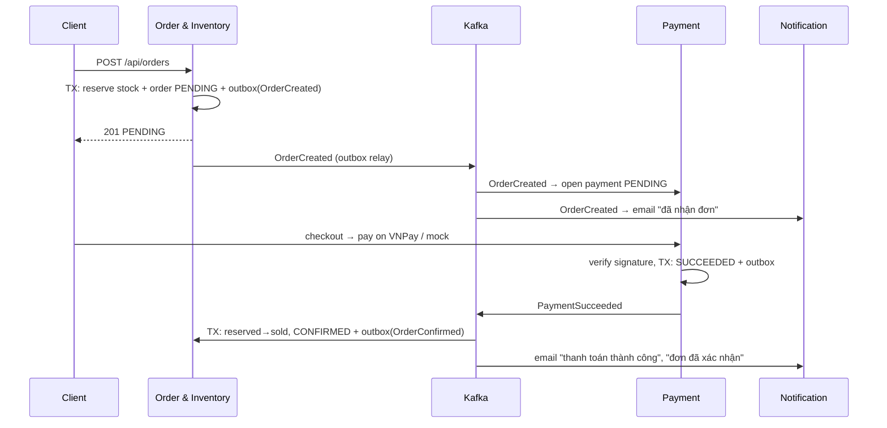

# Thiết kế hệ thống

## 1. Bounded Context (DDD)

| Context | Service | "Sản phẩm" trong context này là gì? | Dữ liệu sở hữu |
|---|---|---|---|
| Identity | identity-service | — | users, user_roles, addresses, refresh_tokens |
| Catalog | product-service | Document đầy đủ: mô tả, thương hiệu, ảnh, thuộc tính tự do, các biến thể (SKU) và giá niêm yết | products, categories (Mongo) + index `products` (ES) |
| Ordering & Inventory | order-service | **Snapshot** tại thời điểm mua: `sku, productName, variantName, unitPrice, quantity` (bảng `order_items`). Đổi giá trong catalog không làm thay đổi đơn cũ | orders, order_items, order_status_history, inventory, stock_reservations |
| Billing | payment-service | Chỉ biết **số tiền** của đơn | payments, payment_transactions |
| Notification | notification-service | Chỉ biết mã đơn, nội dung tin nhắn | notification_logs (Mongo) |

**Tồn kho thuộc Ordering, không thuộc Catalog**: tồn kho thay đổi hàng nghìn lần/giây khi flash sale và cần ACID, còn catalog là dữ liệu đọc nhiều, ghi ít, cấu trúc linh hoạt. Tách ra giúp scale riêng Order & Inventory.

**Database per service**: mỗi service một database và một user PostgreSQL riêng (`deploy/postgres/init-databases.sh`), `REVOKE ALL ... FROM PUBLIC`. Không service nào đọc DB của service khác; dữ liệu đi qua REST, gRPC hoặc Kafka. Trên môi trường thật có thể tách thành nhiều instance mà không đổi code.

## 2. Giao tiếp

| Kiểu | Ở đâu | Lý do |
|---|---|---|
| REST/JSON | Client → Gateway → services | Chuẩn cho client web/mobile, có OpenAPI |
| gRPC (HTTP/2 + Protobuf) | Order → Product (`proto/src/main/proto/product.proto`) | Lời gọi nội bộ, đồng bộ, trên đường nóng của việc đặt hàng; payload nhị phân nhỏ, kết nối HTTP/2 giữ sống, deadline 2 s |
| Kafka (event) | `order.events`, `payment.events` (+ `.DLT`) | Tách rời service: Notification hoặc Payment chết không làm hỏng việc đặt hàng |

Định dạng phản hồi chuẩn ở mọi service:

```json
{ "code": "SUCCESS", "message": "OK", "data": { ... }, "timestamp": "2026-10-26T03:00:00Z" }
{ "code": "OUT_OF_STOCK", "message": "Not enough stock for FLASH-001", "timestamp": "..." }
```

Event Kafka dùng chung một envelope (`common/.../EventEnvelope.java`): `{eventId, eventType, aggregateId, occurredAt, payload}`. Message key = `orderId`, nên mọi event của một đơn nằm cùng partition và giữ đúng thứ tự.

## 3. Xác thực & phân quyền

- Identity phát **access token JWT (HS256, 15 phút)** gồm `sub=userId, email, roles, type=access`, và **refresh token** ngẫu nhiên 48 byte (chỉ lưu SHA-256 trong DB, xoay vòng mỗi lần dùng; dùng lại token cũ ⇒ thu hồi mọi phiên).
- Gateway kiểm tra chữ ký JWT **một lần ở biên**, xóa mọi header `X-User-*` client tự gửi, rồi gắn `X-User-Id / X-User-Email / X-User-Roles` đã xác thực. Các service nằm trong mạng nội bộ, không publish port, nên chỉ nhận header từ gateway.
- RBAC: `CUSTOMER` (mua hàng), `STAFF` (quản lý catalog, kho, giao hàng), `ADMIN` (thêm quản lý user, reindex). Kiểm tra bằng `CurrentUser.requireStaff()/requireAdmin()`.
- Rate limit: token bucket trên Redis (Spring Cloud Gateway `RequestRateLimiter`), khóa theo user khi đã đăng nhập, theo IP khi chưa. Nginx có thêm giới hạn thô theo IP.

## 4. Race condition: 100 người mua 1 sản phẩm còn 1 cái

Cách sai: `SELECT available` → kiểm tra trong Java → `UPDATE available = x - 1`. Hai request cùng đọc `1` và cùng trừ ⇒ bán 2 cái.

Giải pháp dùng 2 lớp (`order-service/.../inventory`):

1. **Lớp đúng đắn – cập nhật có điều kiện trong PostgreSQL** (`InventoryRepository.reserve`):
   ```sql
   UPDATE inventory SET available = available - :qty, reserved = reserved + :qty
   WHERE sku = :sku AND available >= :qty
   ```
   Câu lệnh tự khóa dòng; kiểm tra và trừ là một thao tác nguyên tử. Trả về 0 dòng ⇒ hết hàng. Kèm `CHECK (available >= 0)` ở schema. Đây là lớp đảm bảo **không bao giờ bán âm**, kể cả khi Redis lỗi.
2. **Lớp hiệu năng – Distributed Lock bằng Redis (Redisson MultiLock)** (`InventoryLockService`): khóa theo từng SKU, lấy khóa theo thứ tự đã sắp xếp (không deadlock), `waitTime 3s`, `leaseTime 10s` (tự nhả nếu tiến trình chết). Hàng trăm request xếp hàng trong Redis thay vì cùng chờ khóa dòng ở PostgreSQL và làm cạn connection pool. Quá thời gian chờ ⇒ HTTP 429 `INVENTORY_BUSY`.
3. **Fast path "sold out"**: khi `available` về 0, đặt cờ `inventory:soldout:{sku}` trong Redis; các request sau bị từ chối ngay (409) mà không chạm DB. Cờ được cập nhật trong lúc giữ khóa SKU, sau khi transaction commit, và bị xóa khi hàng được trả lại/nhập thêm.

Vì sao không chỉ dùng Optimistic Locking (`@Version`)? Khi tranh chấp cực cao, gần như mọi request đều xung đột và phải retry ⇒ lãng phí. Pessimistic `SELECT ... FOR UPDATE` đúng nhưng giữ khóa lâu hơn câu UPDATE có điều kiện. Cột `version` vẫn có trong bảng `inventory` để phục vụ các thao tác khác.

## 5. Saga (Choreography)



Các nhánh bù (compensating transaction):

| Tình huống | Hành động bù |
|---|---|
| `PaymentFailed` | Order: `release` (reserved → available), đơn `CANCELLED`, phát `OrderCancelled` |
| Không thanh toán sau 15 phút (`PaymentTimeoutJob`) | Như trên; Payment chuyển giao dịch sang `CANCELLED` |
| Khách/nhân viên hủy đơn đã `CONFIRMED` | Order: `returnSold` (sold → available), `OrderCancelled{refundRequired=true}` → Payment hoàn tiền, phát `PaymentRefunded` |
| Tiền về **sau khi** đơn đã hủy do quá hạn | Order đánh dấu PAID và phát `OrderCancelled{refundRequired=true}` → Payment tự hoàn tiền |
| COD | Xác nhận ngay khi đặt; Payment ghi nhận đã thu khi đơn `COMPLETED` |

Máy trạng thái đơn (`OrderStatus`): `PENDING → CONFIRMED → SHIPPING → COMPLETED`, `PENDING/CONFIRMED → CANCELLED`. Mọi thay đổi ghi vào `order_status_history`.

## 6. Transactional Outbox & Idempotency

- Ghi thay đổi nghiệp vụ và dòng `outbox_events` trong **cùng một transaction** (`OutboxWriter`, `Propagation.MANDATORY`). Không có chuyện lưu đơn thành công mà mất event, hoặc ngược lại.
- `OutboxRelay` quét mỗi 300 ms: `SELECT ... FOR UPDATE SKIP LOCKED LIMIT 200` (chạy được nhiều replica), gửi Kafka với `acks=all`, idempotent producer, đánh dấu `published_at`. Kafka chết ⇒ event nằm chờ trong bảng và được gửi lại; metric `outbox_pending` hiển thị trên Grafana.
- Đảm bảo **at-least-once** ⇒ consumer phải idempotent: Order/Payment lưu `processed_events(event_id)` trong cùng transaction xử lý; Notification dùng unique index `(eventId, channel)` nên không gửi email trùng.
- Lỗi xử lý: `DefaultErrorHandler` retry với exponential back-off, sau đó đẩy sang `<topic>.DLT` để không chặn partition.
- API đặt hàng nhận header `Idempotency-Key` (unique `(user_id, idempotency_key)`): client bấm 2 lần / retry do mạng chập chờn vẫn chỉ tạo 1 đơn.

## 7. Tính sẵn sàng & suy giảm có kiểm soát

| Thành phần ngừng | Ảnh hưởng |
|---|---|
| Notification | Không ảnh hưởng đặt hàng/thanh toán; email được gửi bù từ Kafka khi service sống lại |
| Elasticsearch | Tìm kiếm tự chuyển sang MongoDB (regex), health không bị DOWN |
| Redis (lock) | Order chuyển sang khóa dòng của PostgreSQL, vẫn đúng tồn kho (metric `inventory_lock_redis_fallbacks`) |
| Kafka | Đặt hàng vẫn thành công; event chờ trong outbox |
| Product | Đặt hàng trả 503 rõ ràng (cần giá để tạo đơn); các trang khác vẫn hoạt động |
| Payment | Đặt hàng vẫn thành công; đơn chờ thanh toán, tự hủy nếu quá hạn |

## 8. Observability

- **Metrics**: Micrometer → `/actuator/prometheus` → Prometheus → Grafana (dashboard `Omnichannel - Overview`: req/s, p95, 5xx, đơn tạo/bị từ chối, outbox pending, heap, CPU).
- **Logs**: Promtail đọc stdout mọi container → Loki. Mỗi dòng log có `[service,traceId,spanId]`; trong Grafana bấm traceId để mở trace trên Jaeger.
- **Tracing**: Micrometer Tracing + OpenTelemetry (OTLP HTTP) → Jaeger. Trace đi qua Gateway → Order → gRPC Product, và qua Kafka (observation bật cho producer/consumer).
